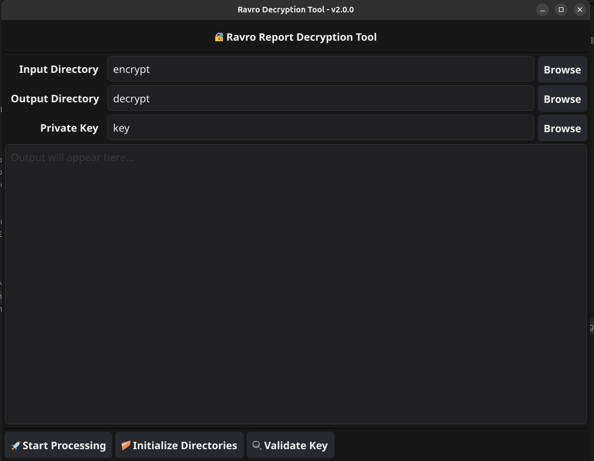

# Ravro Decryption Tool

A versatile Go-based tool for decrypting and converting Ravro platform bug bounty reports to standalone HTML.

## 🚀 Introduction

`ravro_dcrpt` is a cross-platform utility designed to decrypt and process reports submitted by hunters on the Ravro platform, embodying the "write once, run anywhere" philosophy of Go.

## ⚡ Quick Start

1. **Install prerequisites** using the autoinstall scripts (see Installation section)
2. **Download** the latest release for your platform from [Releases](https://github.com/ravro-ir/ravro_dcrpt/releases)
3. **For GUI users**: Double-click `ravro_dcrpt_gui` and use the visual interface
4. **For CLI users**: Run `./ravro_dcrpt -init` to set up directories, then `./ravro_dcrpt` for interactive mode

## ✨ Features

### Core Features
- 🔐 **PKCS7 Decryption** using OpenSSL (CGO-based for native performance)
- 📄 **HTML export** using the frontend report template (standalone, styled reports)
- 🗝️ **Multi-key support** for different organizations
- 🔄 **Batch processing** - multiple reports in one go
- 📦 **ZIP extraction** - automatic handling of compressed reports
- 🖥️ **Cross-platform** - Windows, Linux, macOS

### User Interface
- 🎨 **GUI Application** - User-friendly Fyne-based interface
  - Large file browser dialogs (1000×700) for easy navigation
  - Real-time processing logs and status
  - Directory initialization wizard
  - Key validation before processing
- 💻 **CLI Application** - Perfect for automation and scripting
  - Interactive and command-line modes
  - JSON export support
  - Colored output and progress indicators

### HTML Features
- 📅 **Persian Date Conversion** - Automatic Gregorian to Shamsi (Jalali) conversion
- 💰 **Formatted Amounts** - Thousand separators for rewards (e.g., 10,500,000 ریال)
- 📎 **Attachment Tables** - Beautiful tables showing attachment files with types
- 🎨 **Modern Design** - Clean, professional styling with Vazirmatn font
- 🌐 **RTL Support** - Full right-to-left layout for Persian content
- ⚖️ **Conditional Sections** - Judge information shown only when available
- 🧬 **Dual report schema** - Legacy flat JSON and backend-api v2 envelopes (`schemaVersion`) share one HTML template

## 🛠️ Installation

### Quick Installation (Recommended)

We provide automated installation scripts that install all required dependencies for running the GUI application.

#### Linux
```bash
# Download and run the installation script
curl -O https://raw.githubusercontent.com/ravro-ir/ravro_dcrpt/main/install-linux.sh
chmod +x install-linux.sh
./install-linux.sh
```

**Supported distributions:**
- Ubuntu / Debian / Linux Mint / Pop!_OS
- Fedora / RHEL / CentOS / Rocky / AlmaLinux  
- Arch Linux / Manjaro
- openSUSE / SLES

#### macOS
```bash
# Download and run the installation script
curl -O https://raw.githubusercontent.com/ravro-ir/ravro_dcrpt/main/install-macos.sh
chmod +x install-macos.sh
./install-macos.sh
```

**Note:** The script will automatically install Homebrew if not present.

#### Windows
```powershell
# Download and run the installation script
# Run PowerShell as Administrator, then:
Invoke-WebRequest -Uri "https://raw.githubusercontent.com/ravro-ir/ravro_dcrpt/main/install-windows.ps1" -OutFile "install-windows.ps1" -UseBasicParsing
powershell -ExecutionPolicy Bypass -File "install-windows.ps1"
```

**Note:** Must be run as Administrator. The script will:
- Install Chocolatey (if not present)
- Try to install OpenSSL from multiple sources (versions 3.4.0, 3.3.2, 3.3.1, 3.3.0, 3.2.0, 3.1.0)
- Fallback to Chocolatey if direct download fails
- Automatically configure system PATH

### Download Application

After installing prerequisites, download the latest release for your platform:

**Linux (x86_64):**
```bash
wget https://github.com/ravro-ir/ravro_dcrpt/releases/latest/download/ravro_dcrpt-linux-amd64.tar.gz
tar -xzf ravro_dcrpt-linux-amd64.tar.gz
chmod +x ravro_dcrpt_gui
./ravro_dcrpt_gui
```

**macOS (Intel):**
```bash
wget https://github.com/ravro-ir/ravro_dcrpt/releases/latest/download/ravro_dcrpt-darwin-amd64.tar.gz
tar -xzf ravro_dcrpt-darwin-amd64.tar.gz
open "Ravro Decryption Tool.app"
```

**macOS (Apple Silicon):**
```bash
wget https://github.com/ravro-ir/ravro_dcrpt/releases/latest/download/ravro_dcrpt-darwin-arm64.tar.gz
tar -xzf ravro_dcrpt-darwin-arm64.tar.gz
open "Ravro Decryption Tool.app"
```

**Windows:**
```powershell
# Download from GitHub Releases
# Extract the zip file, then run:
.\ravro_dcrpt_gui.exe
```

📖 **For detailed installation instructions, troubleshooting, and manual installation, see [INSTALL.md](INSTALL.md)**

## 📂 Project Structure

### Clean Architecture Layout

```
ravro_dcrpt/
├── cmd/                          # Application entry points
│   ├── cli/main.go              # CLI application
│   └── gui/main.go              # GUI application
├── internal/                     # Internal packages
│   ├── adapters/                # Interface implementations
│   │   ├── crypto/              # PKCS7 decryption (OpenSSL CGO)
│   │   ├── pdfgen/              # HTML report export (frontend template)
│   │   └── storage/             # File system operations
│   ├── core/                    # Business logic
│   │   ├── decrypt/             # Decryption service
│   │   └── report/              # Report processing service
│   └── ports/                   # Interface definitions
├── pkg/                         # Public packages
│   └── models/                  # Data models
├── .github/workflows/           # CI/CD pipelines
├── BUILD.md                     # Comprehensive build guide
└── README.md                    # This file
```

### Working Directory Structure

```
.
├── decrypt/                     # Output directory
│   └── ir2025-02-27-0055/
│       ├── company__id__hunter.html   # Generated HTML report
│       ├── report/              # Decrypted report data
│       └── amendment-1/         # Decrypted attachments
├── encrypt/                     # Input directory
│   ├── ir2025-02-27-0055.zip    # Compressed report
│   └── ir2025-02-27-0055/       # Or extracted report folder
│       ├── report/
│       │   └── data.ravro       # Encrypted report (v1 flat or v2 envelope)
│       ├── comments.json        # Optional (new ZIP layout)
│       ├── judgment/
│       │   └── data.ravro       # Encrypted judgment (legacy, optional)
│       ├── amendment-1/         # Management spelling
│       │   └── data.ravro
│       └── ammendment-1/        # backend-api spelling
│           └── data.com.ravro   # Company-side extra payload
└── key/                         # Private keys directory
    └── COMPANY-PRIVATEKEY.txt   # Private key file
```

## 💻 Usage

### GUI Application (Recommended for Desktop Users)

Simply double-click `ravro_dcrpt_gui` to launch the graphical interface.



**Features:**
- 📁 **Large file browsers** (1000×700) - Browse and select directories/files easily
- 🔑 **Key validation** - Validate private key before processing
- 📊 **Live logs** - Real-time processing status and progress
- ✅ **Directory initialization** - One-click setup of required folders
- 🎯 **Visual feedback** - Clear status messages and error handling

**Steps:**
1. Click "📁 Initialize Directories" to create `encrypt/`, `decrypt/`, and `key/` folders (first time only)
2. Click "Browse" next to each field to select:
   - **Input Directory**: Your encrypted reports folder or specific report
   - **Output Directory**: Where HTML reports will be saved
   - **Private Key**: Your `.pem` or `.txt` key file
3. (Optional) Click "🔍 Validate Key" to verify your key
4. Click "🚀 Start Processing" to decrypt and generate HTML reports
5. Check the log area for detailed progress and any errors

### 📄 Generated HTML Features

The generated HTML reports include:

**✅ Report Information:**
- Report ID and submission date (Persian calendar)
- Hunter username and target company
- Activity date range (Persian dates)
- Current status and target details
- IP addresses and URLs

**✅ CVSS Scoring:**
- Hunter's CVSS vector and score
- Judge's CVSS evaluation (if available)
- Severity ratings with color coding

**✅ Vulnerability Details:**
- Scenario description (with Markdown support)
- Proof of Concept with full details
- Technical description

**✅ Attachments:**
- Organized in a table format
- File numbering, names, and types
- Automatic file type detection (Image/PDF/File)

**✅ Judge Information (when available):**
- Reward amount with thousand separators (e.g., 10,500,000 ریال)
- Judge's comments and recommendations
- Vulnerability definition and fix suggestions
- Review date (Persian calendar)

**✅ Styling:**
- Clean, professional design
- Persian (Farsi) Vazirmatn font
- Right-to-left (RTL) layout
- Color-coded severity badges
- Responsive table layouts

## 🛠️ Technologies & Dependencies

This project is built with:

**Core:**
- **Go 1.21+** - Primary programming language
- **CGO** - C bindings for native library integration

**Cryptography:**
- **OpenSSL** - PKCS7 encryption/decryption via CGO
- **go.mozilla.org/pkcs7** - Pure Go PKCS7 support (fallback)

**HTML export:**
- **html/template-equivalent renderer** - Frontend report template ported to Go
- Embedded Vazirmatn font for offline viewing

**GUI Framework:**
- **Fyne v2** - Cross-platform GUI toolkit (Pure Go)

**CLI Framework:**
- **Cobra** - Command-line interface framework

**Utilities:**
- **go-persian-calendar** - Gregorian to Shamsi (Jalali) date conversion
- **archive/zip** - ZIP file extraction

**Fonts:**
- **Vazirmatn** - Modern Persian font from Google Fonts

## 🔨 Building from Source

For comprehensive build instructions including cross-compilation and troubleshooting, see **[BUILD.md](BUILD.md)**.

### Quick Build


**Linux/macOS:**
```bash
git clone https://github.com/ravro-ir/ravro_dcrpt.git
cd ravro_dcrpt
make build
```


**📘 See [BUILD.md](BUILD.md) for:**
- Prerequisites and dependencies
- Platform-specific instructions
- Cross-compilation guide
- Troubleshooting common issues

### 🍎 macOS Special Notes

Use the macOS build script so OpenSSL CGO flags are set correctly:

```bash
./build_macos.sh
```


## 📋 Changelog

See [CHANGELOG.md](CHANGELOG.md) for detailed release notes and version history.

## 📄 License

GNU General Public License, version 3

## 👥 Author

Ramin Farajpour Cami
- Email: ramin.blackhat@gmail.com
- Alternate Email: farajpour@ravro.ir

